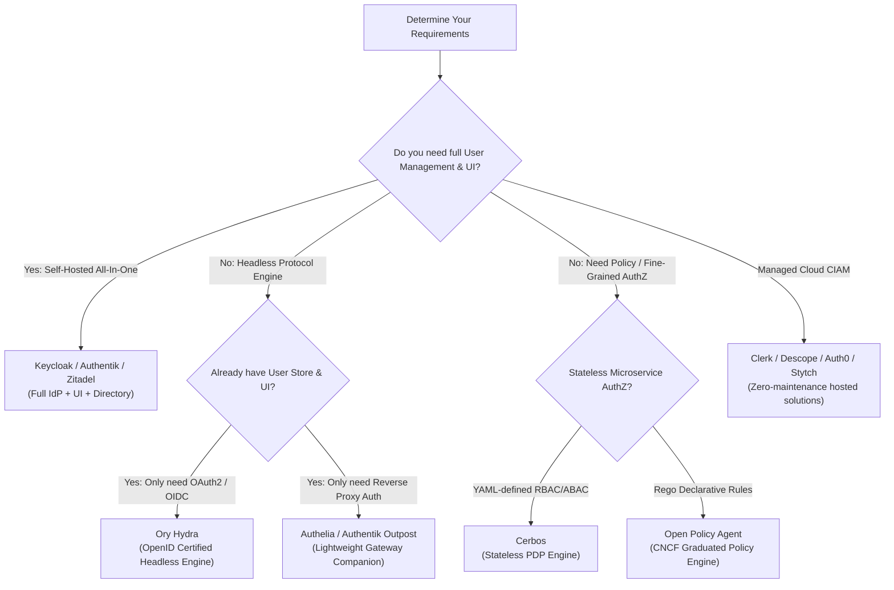

# Awesome API Authorization Protocols & Identity Engines 🔐

  
  
  
  
  
  

**A curated, production-ready guide to API authorization protocols, OAuth 2.0 / 2.1, OpenID Connect (OIDC), JWT & JWKS validation, API keys, passwordless auth, and self-hosted identity servers.** 🚀

*Last updated: November 2026* • 🌟 **Star if you find this valuable!** 🌟

---

## 📖 Table of Contents

- [📊 Sector Overview & Market Dynamics](#-sector-overview--market-dynamics)
- [🏢 SaaS & Hosted Identity Platforms](#-saas--hosted-identity-platforms)
- [💻 Open-Source Identity Engines & AuthZ Gateways](#-open-source-identity-engines--authz-gateways)
- [💡 Architectural Guidance: Choosing Your Protocol Engine](#-architectural-guidance-choosing-your-protocol-engine)
- [🤝 How to Contribute](#-how-to-contribute)
- [💖 Support](#-support)
- [⭐ Star History](#-star-history)
- [⚖️ Disclaimer](#️-disclaimer)

---

## 📊 Sector Overview & Market Dynamics

The global Identity and Access Management (IAM) and Customer IAM (CIAM) market is valued at **$20B–$26B in 2024–2025** and projected to exceed **$30B by 2027**, compounding at an annual growth rate (CAGR) of 12%–16%. 

The industry exhibits a **moderately concentrated, bifurcated market structure**:
- **Consolidated Enterprise Tier**: Mega-enterprise workforce SSO and legacy CIAM deployments are dominated by a handful of established leaders (Okta/Auth0, Ping Identity/ForgeRock, Microsoft Entra ID).
- **Dynamic Developer Ecosystem**: Developer-first authentication, API microservice authorization (RBAC/ABAC/ReBAC), and AI-agent identity infrastructure remain vibrant and moderately fragmented. Rapidly growing startups (Clerk, Descope, Stytch, FusionAuth) and open-source engines (Keycloak, Authentik, Authelia, Ory Hydra, Zitadel, SuperTokens, Logto) are capturing modern cloud-native, edge, and agentic workflows.

---

## 🏢 SaaS & Hosted Identity Platforms

Below is a breakdown of prominent hosted identity and API authorization platforms, sorted in descending order by **company scale (valuation / market capitalization)**.

| Platform | Company Scale (Valuation / Revenue) | Starting Paid Pricing | Free Tier Limits | Description & Best For | Trade-offs |
|---|---|---|---|---|---|
| **Okta** 🛡️ | **$15.3B Market Cap** ($2.61B ARR in FY2025) | Starter from **$6/user/month** (Essentials from $17/user/month; Workforce IAM) | **30-day free trial** (SSO, Universal Directory, & Adaptive MFA for up to 100 test users; Integrator developer tier available) | Enterprise workforce identity, lifecycle management, and enterprise SSO alongside OAuth/OIDC. | Workforce-centric; customer identity is delegated to Auth0; complex enterprise procurement. |
| **Auth0** *(by Okta)* 🔑 | **$6.5B Acquisition Valuation** (~$350M+ ARR at acquisition) | Essentials from **$35/month** (Professional from $240/month; Enterprise custom) | **Free forever up to 25,000 MAUs** (Unlimited social connections, basic MFA, custom domains, and community support) | Developer-friendly CIAM with polished OAuth 2.0/OIDC implementation, extensive SDKs, and Quickstarts. | Premium steep pricing curve as MAUs scale beyond entry tiers; CIAM focus rather than internal employee SSO. |
| **Postman** 📮 | **$5.6B Peak Valuation** (~$313M estimated ARR) | Solo from **$9/month** (Team collaboration from $19/user/month billed annually) | **Free forever for 1 user** (Unlimited collection runs, unlimited local/cloud mock servers, 1,000 API monitoring calls/mo, and 50–100 AI credits/mo; no team workspaces) | API client and platform with built-in OAuth 1.0/2.0, JWT, and API Key authorization debugging/testing. | Development & testing tool only; **not** a production authorization or token-issuing identity server. |
| **Ping Identity** *(incl. ForgeRock)* 🌐 | **$2.8B Acquisition Value** (~$300M+ ARR when taken private by Thoma Bravo) | **Custom Enterprise Quote** (Annual contract starting at ~$20,000+/year) | **30-day free trial** (Full feature access to PingOne orchestration, SSO, MFA, and user directories in trial sandbox) | Complex enterprise customer journeys, federation, hybrid deployments, and advanced risk/fraud signals. | Heavier enterprise setup; lacks self-serve transparent micro-pricing tiers. |
| **Stytch** *(acquired by Twilio)* ⚡ | **$1.0B Series B Valuation** (~$12M–$14M ARR; acquired by Twilio) | Usage-based starting at **$0/month base** ($0.05/MAU or $0.10/B2B member above free tier allowance) | **Free forever up to 10,000 MAUs** (Unlimited B2B orgs, up to 5 SSO/SCIM connections, 1,000 M2M tokens, 10,000 device fingerprints; no feature gating) | API-first passwordless authentication, passkeys, device fingerprinting, and agentic identity orchestration. | Acquired by Twilio; smaller third-party ecosystem compared to legacy Okta/Auth0 catalogs. |
| **Clerk** ⚛️ | **~$300M+ Valuation** (Series C raised $50M in late 2025; ~$15M–$30M ARR) | Pro from **$25/month** (Business from $300/month; Enterprise custom) | **Free forever up to 50,000 MRUs** (Monthly Retained Users; 3 admin seats, unlimited apps, custom domains, community support) | Prebuilt plug-and-play UI components for React, Next.js, and modern JS/TS web applications. | Primarily optimized for JavaScript/TypeScript stacks; less idiomatic for non-web backend protocols. |
| **Descope** 🎨 | **~$210M–$500M Est. Valuation** ($88M total funding; ~$10M–$14M est. ARR) | Pro from **$249/month** (Growth from $799/month; Enterprise custom) | **Free forever up to 7,500 MAUs** (Up to 10 tenants, 3 SSO connections, drag-and-drop workflow canvas, passwordless & MFA) | Visual no-code drag-and-drop authentication and authorization flow orchestration with fraud defense. | Newer platform; deep custom logic edge-cases may require code hooks outside visual designer. |
| **FusionAuth** 🔥 | **~$150M–$250M Est. Valuation** ($65M growth equity round; ~$15M–$30M est. ARR) | Starter Cloud from **$162/month** (Essentials from $2,970/month; Enterprise custom) | **Free forever with Unlimited MAUs** (Self-hosted Community Edition on Docker/Kubernetes/bare-metal with full OAuth/OIDC/SAML support) | Self-hostable or dedicated single-tenant cloud identity platform with predictable, volume-agnostic pricing. | Cloud tiers require baseline monthly spend; self-hosted free tier requires self-managing databases and upgrades. |

---

## 💻 Open-Source Identity Engines & AuthZ Gateways

Curated open-source identity providers, headless OAuth 2.0 / OIDC servers, token verification gateways, and policy engines. **Sorted in descending order by GitHub_Stars.**

| Repository | GitHub_Stars_Badge | Primary Focus / Protocol Support | Tech Stack | License |
|---|---|---|---|---|
| **[Keycloak](https://github.com/keycloak/keycloak)** 👑 |  | Full enterprise IAM & IdP, OAuth 2.0 / OIDC 1.0, SAML 2.0, LDAP/AD federation, User federation, SCIM 2.0 | Java (Quarkus) | Apache-2.0 |
| **[Authelia](https://github.com/authelia/authelia)** 🛡️ |  | Lightweight authentication and authorization server, companion proxy (Traefik/Nginx), OIDC Provider, 2FA/FIDO2 WebAuthn | Go, TypeScript | Apache-2.0 |
| **[Authentik](https://github.com/goauthentik/authentik)** 🎛️ |  | Flexible flow-based IdP, reverse proxy outpost, OAuth 2.0, OpenID Connect, SAML, LDAP, SCIM sync | Python, Go | MIT / BSL |
| **[Ory Hydra](https://github.com/ory/hydra)** ⚡ |  | OpenID Foundation Certified OAuth 2.0 & OIDC token engine (Headless; BYO database & login UI) | Go | Apache-2.0 |
| **[Zitadel](https://github.com/zitadel/zitadel)** 🏢 |  | Cloud-native, multi-tenant identity infrastructure, OAuth 2.0, OIDC, SAML, Passkeys, audit logs | Go, TypeScript | AGPL-3.0 |
| **[SuperTokens](https://github.com/supertokens/supertokens-core)** 🧩 |  | Modular Auth & session management architecture, anti-CSRF tokens, JWT validation, passwordless, social auth | Java, Node / Go / Python SDKs | Apache-2.0 |
| **[Logto](https://github.com/logto-io/logto)** 🎯 |  | Modern CIAM alternative to Auth0, developer-friendly UI, OIDC, RBAC, Webhooks, native MCP server support | TypeScript (Node.js) | MPL-2.0 |
| **[Casdoor](https://github.com/casdoor/casdoor)** 🤖 |  | AI-native IAM platform with built-in MCP server, OAuth 2.1, OIDC, SAML, CAS, RADIUS, Casbin RBAC/ABAC | Go, React | Apache-2.0 |
| **[Open Policy Agent (OPA)](https://github.com/open-policy-agent/opa)** 📜 |  | General-purpose policy engine for unified authorization across microservices, Kubernetes, CI/CD, & API gateways | Go (Rego language) | Apache-2.0 |
| **[Dex IdP](https://github.com/dexidp/dex)** 🔄 |  | Federated OpenID Connect and OAuth 2.0 identity broker (plugs into LDAP, SAML, GitHub, Google, GitLab) | Go | Apache-2.0 |
| **[Cerbos](https://github.com/cerbos/cerbos)** 🚦 |  | Context-aware authorization PDP for application microservices, YAML-defined stateless RBAC & ABAC policies | Go | Apache-2.0 |

---

### Detailed Project Deep-Dives 🔍

- **[Keycloak](https://github.com/keycloak/keycloak)**: The enterprise battle-tested standard maintained under the CNCF / Red Hat umbrella. It provides full user management, custom themes, LDAP/Active Directory federation, and native SAML 2.0 / OIDC bridging.
  - *Best for*: Large enterprise deployments, directory federation, non-engineer administrators.
  - *Trade-off*: Resource-heavy Java footprint compared to lightweight Go binaries.

- **[Authelia](https://github.com/authelia/authelia)**: An ultra-fast, single-binary authentication and authorization companion for reverse proxies like Traefik, Nginx, Caddy, and Envoy. It acts as an OpenID Connect provider and implements 2FA (WebAuthn/FIDO2, TOTP, Duo).
  - *Best for*: Homelabs, self-hosters, and teams needing reverse-proxy forward-auth with OIDC.
  - *Trade-off*: Focused on proxy gatekeeping and standard auth; not a full B2B customer identity portal.

- **[Authentik](https://github.com/goauthentik/authentik)**: A versatile IdP offering an expressive stage-and-flow pipeline editor. Includes an integrated reverse proxy outpost and clean UI.
  - *Best for*: Teams looking for modern user self-service, custom login stage pipelines, and reverse-proxy outpost routing.
  - *Trade-off*: Enterprise multi-tenant isolation requires a commercial license.

- **[Ory Hydra](https://github.com/ory/hydra)**: The OpenID Certified OAuth 2.0 and OpenID Connect engine that separates token issuance and security from user databases.
  - *Best for*: Microservice teams and SaaS providers that already possess a user directory and only need hardened token generation, delegation, and consent endpoints.
  - *Trade-off*: Headless architecture requires engineering teams to build their own login, consent, and error interfaces.

- **[Zitadel](https://github.com/zitadel/zitadel)**: Built from the ground up for Kubernetes and cloud-native ecosystems with strict multi-tenancy (Organizations and Projects) and audit trail immutability.
  - *Best for*: B2B SaaS platforms requiring tenant isolation and self-service administration portals.
  - *Trade-off*: AGPL-3.0 licensing considerations.

- **[SuperTokens](https://github.com/supertokens/supertokens-core)**: Modular authentication architecture offering granular recipe-based integration (Session management, Passwordless, Social login, MFA, and User Roles).
  - *Best for*: Fullstack developers seeking pre-built SDKs with deep database integration and transparent session security.
  - *Trade-off*: Architecture pairs an API middleware layer with the core backend service.

- **[Logto](https://github.com/logto-io/logto)**: Open-source Auth0 alternative providing quick SDK integration, modern administrative dashboards, and support for OAuth 2.1 protocol extensions tailored for AI Agent contexts.
  - *Best for*: Startups and application developers wanting modern out-of-the-box UI with fast integration.
  - *Trade-off*: Younger project ecosystem compared to Keycloak.

- **[Casdoor](https://github.com/casdoor/casdoor)**: UI-first identity platform with support for over 70 social providers, integrated Model Context Protocol (MCP) server endpoints, and Casbin authorization policy syntax.
  - *Best for*: Web applications, AI agents requiring OAuth 2.1 authentication, and multi-protocol federation (SAML/CAS/RADIUS).
  - *Trade-off*: Smaller community footprint and third-party tutorials.

- **[Open Policy Agent (OPA)](https://github.com/open-policy-agent/opa)**: A graduated CNCF policy engine that decouples authorization logic from your software using the declarative query language Rego.
  - *Best for*: Fine-grained authorization across microservice APIs, Kubernetes admission control, and service meshes (Envoy/Istio).
  - *Trade-off*: Requires mastering Rego query syntax.

- **[Dex IdP](https://github.com/dexidp/dex)**: A lightweight OpenID Connect identity broker that talks to LDAP, SAML, GitHub, and other upstream identity providers to issue standard OIDC tokens.
  - *Best for*: Kubernetes cluster authentication and unified single sign-on broker setups.
  - *Trade-off*: Solely a broker; does not maintain its own user database.

- **[Cerbos](https://github.com/cerbos/cerbos)**: Stateless, context-aware policy engine that answers authorization queries (`can user X perform action Y on resource Z?`) using human-readable YAML policies.
  - *Best for*: Microservices and cloud-native APIs requiring dynamic RBAC/ABAC without hardcoding permissions.
  - *Trade-off*: Dedicated PDP service layer to run alongside your application.

---

## 💡 Architectural Guidance: Choosing Your Protocol Engine

---

## 🤝 How to Contribute

Contributions are warmly welcomed! Help keep this curated list accurate and up-to-date:

1. 🍴 **Fork the repository**.
2. 🌿 **Create a feature branch** (`git checkout -b feature/new-identity-protocol`).
3. 📝 **Add or edit entries** in `README.md` following the tabular and deep-dive formats. Ensure descriptions are factual, verified, and include licensing.
4. ✨ **Submit a Pull Request** with a concise description of your additions.

---

## 💖 Support

If you find this repository helpful in designing or maintaining your authorization infrastructure, please consider supporting the project:

- ⭐ **Star this repository** to improve discoverability!
- 🍴 **Fork and share** with colleagues and security teams.
- ☕ **Buy a coffee**: Sponsor ongoing open-source research and curated resources on the [GitHub Sponsors Dashboard](https://github.com/sponsors/ishandutta2007).

---

## ⭐ Star History

---

## ⚖️ Disclaimer

- This is a **community-curated collection** intended for educational and architectural reference—not a formal security endorsement.
- Authorization servers manage private keys, token lifetimes, cryptographic signatures, and confidential client credentials. **Strict adherence to RFC 6749, RFC 6750, RFC 7519, RFC 8725, and OAuth 2.1 BCP guidelines is imperative to prevent token forgery, leakage, and replay attacks.**
- Review all software licenses and consult security professionals before deploying authorization servers into production environments.

---

**Built with ❤️ for identity engineers, API architects, and security practitioners.**

